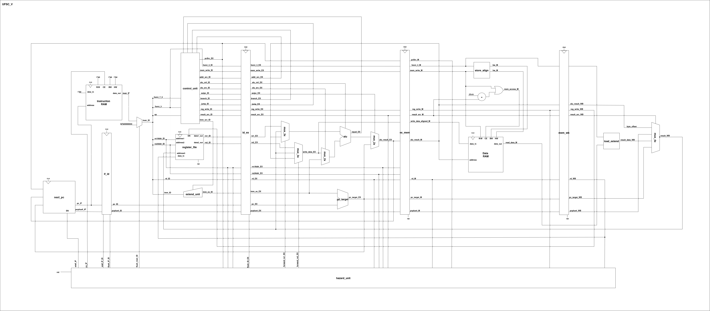

# UFSC-V: 32-bit RISC-V (RV32E) Pipelined Core

The UFSC-V is an embedded 32-bit RISC-V microprocessor core implementing the RV32E base integer instruction set. It features a classic 5-stage in-order pipeline with full hazard detection and data forwarding, tailored for area-constrained and FPGA-targeted embedded applications.

*Figure 1: Block diagram of the UFSC-V core microarchitecture.*

## Architectural Highlights
- **Instruction Set Architecture (ISA):** RISC-V RV32E (Base Integer with reduced 16-register set: `x0`–`x15`).
- **Pipeline Architecture:** 5 stages (`IF`, `ID`, `EX`, `MEM`, `WB`).
- **Memory Model:** Harvard architecture with separate instruction and data memory interfaces.
- **Hazard Handling:**
  - **Data Forwarding:** Forwarding paths from `EX/MEM` and `MEM/WB` stages back to `ID/EX` ALU operands.
  - **Load-Use Stall:** Hardware hazard unit detects dependencies following memory loads and inserts a 1-cycle pipeline bubble.
  - **Branch / Jump Resolution:** Evaluated with pipeline flushing on taken control transfers.
- **Memory Operations:** Supports aligned byte (`LB`/`LBU`/`SB`), halfword (`LH`/`LHU`/`SH`), and word (`LW`/`SW`) operations via dedicated byte-enable (`bw`) and halfword-enable (`hw`) strobe signals.

## Pipeline Stages & Hazard Management
1. **Instruction Fetch (IF):** Generates next PC value, handles PC redirection from branches/jumps, and fetches instruction words.
2. **Instruction Decode (ID):** Decodes instruction type, extracts immediate values, and reads the 16-entry register file (`x0`–`x15`).
3. **Execute (EX):** Computes arithmetic/logical operations, branch targets, and memory effective addresses. Forwarding multiplexers resolve data hazards.
4. **Memory (MEM):** Drives data memory read/write controls and aligns write data.
5. **Write-Back (WB):** Selects between ALU results, memory read data, and PC targets, committing the result back to the register file.