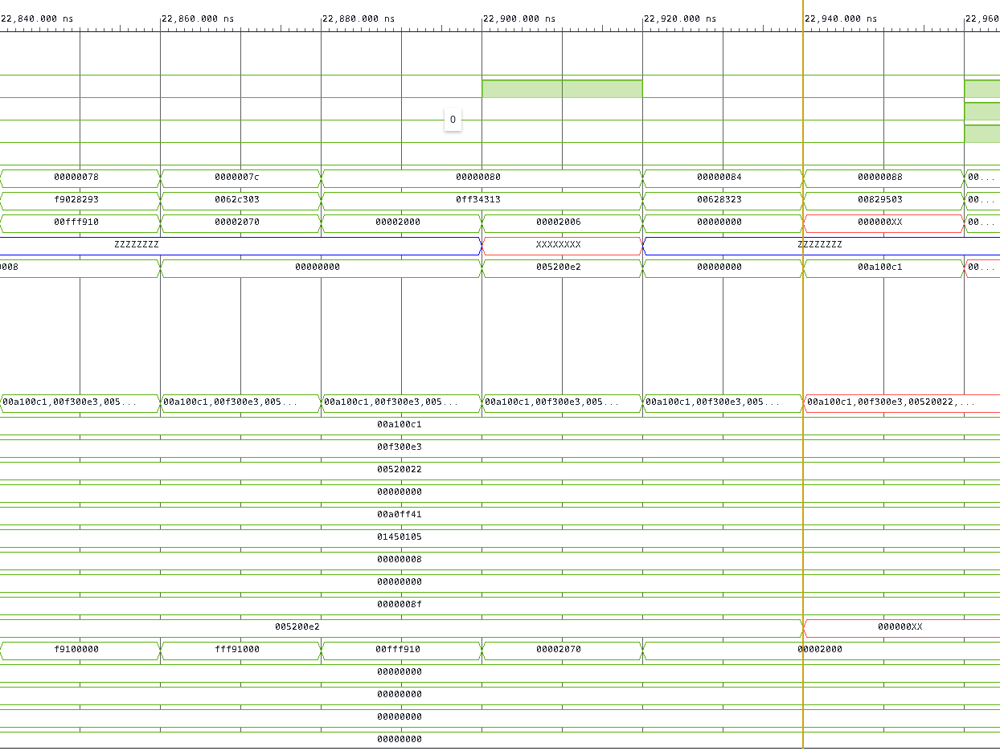

# The UFSC-V Testbench

The testbench used to validate the UFSC-V core through software was the MIPS_S testbench developed by Ney Calazans, which was modified to meet the UFSC-V specs.

The assembly file testing all the core instructions had to be adapted to fit the UFSC-V instructions. The number of registers was limited to 16 (RV32E). The store/load half instructions were added because the MIPS_S did not handle halfwords. Some jump/branch mnemonics needed to be adapted. Also, some instructions were executing assuming 16-bit immediate values, and therefore they needed to be adapted to the 12-bit format supported by the RV32E.
However, the verification logic of the testbench program remained the same, executing the basic instructions of the core, followed by vector manipulation and calling of subroutines.

The testbench itself is run on a VHDL file (`UFSC_V_Sim_tb.vhd`) that was also developed for the MIPS_S. It defines and instantiates RAM memories for data and text segments, reads a `.txt` file to load data into these memories, and then executes the program stored in the instruction memory. It also needed to be adapted to the UFSC-V core, providing halfword accesses to the memory. The changes were marked with the `--MODIFIED:` comment. 

The `.txt` file provided to the VHDL testbench was generated with the RISC-V simulator RARS, by the dump memory option in the software. The data and text segments were dumped separately, and put together manually, following the instructions provided by the MIPS_S testbench tutorial.

The changes made to the core to fit the testbench were:
- The `store_align` unit was modified. Previously, it handled the byte mask and data manipulation, but currently, it only drives a `bw` (byte-write) and a `hw` (halfword-write) signal. The data manipulation and store logic is done inside the RAM memory in the testbench.
- Naturally, due to the changes above, some signals like `o_write_data_aligned` and `o_we_mask` were no longer needed, so they were commented out.
- The `load_extend` unit was also modified. If the RAM memory of the testbench can handle unaligned memory access, the only functionality required of the load extend unit is to cut off the unused bits. So the load extend unit was reduced.
- Changed the reset state of the registers to 0, to facilitate comparison with the RARS simulator.

## Testbench with Asynchronous Memories

### Bugs Found

#### AUIPC Instruction
During the execution of the instructions below, a forwarding error was found.

```text
0x00000070  0x00002297  auipc x5,2                   103          la      t0,array
0x00000074  0xf9028293  addi x5,x5,0xffffff90
```

The instruction above (`auipc`) executes the sum (`PC + {imm, 12'b0}`) in the `pc_target` module, not the `alu`. That causes the forwarding logic to choose the wrong result, causing an error. To fix that, a simple mux was added in the `stage_execute`, choosing the result between the `pc_target` or `alu_result`, for the `auipc` instruction.

#### result_src_ID Signal

Now, the `result_src_ID` propagates `2'bxx` for `B_TYPE` and `S_TYPE` instructions. It didn't affect the rest of the testbench, but it's worth checking if this is correct. Maybe a better solution would be defining this signal as 0 for this type of instructions. See the code below:

```verilog
assign o_result_src_ID =
    (i_op == R_TYPE)       ? 2'b00 :  // ALU result
    (i_op == I_TYPE_LOAD)  ? 2'b10 :  
    (i_op == I_TYPE_ARITH) ? 2'b00 :  
    (i_op == I_TYPE_JALR)  ? 2'b01 :  
    (i_op == J_TYPE_JAL)   ? 2'b01 :  
    (i_op == U_TYPE_LUI)   ? 2'b00 :  
    (i_op == U_TYPE_AUIPC) ? 2'b11 :  
    2'bxx;  
```

It should be investigated because this causes the hazard unit to generate an undefined signal for flushes and stall wires. For the `B_TYPE` and `S_TYPE`, the `reg_write` signal is already 0, so the write back mux result doesn't matter.

### Conclusion
Apart from the bugs found above (of which the functional ones were fixed), the simulation terminated with no errors. All the instructions were tested and operated correctly.

## Testbench with Synchronous Memories

The former testbench was executed with asynchronous memories. As the memories that are going to be used in the hardware validating step of the project are synchronous, a different version of the test was made, applying the synchronous reading/writing to the code.

In this testbench, the memories were adapted to be synchronous to the clock (BRAM behavior). Due to the 1-cycle read latency introduced by synchronous memories, the core requires pipeline adaptations (or the use of distributed RAM) to function correctly.

### Bugs Found

#### BRAM Delay
Because we are prototyping with synchronous read/write memories (BRAMs), running the testbench initially introduced a 1-cycle delay between fetching an instruction and decoding it. This happened due to the synchronous read behavior of the instruction memory, which already registers its output on the clock edge.

This was fixed by removing the instruction register from the `if_id` pipeline register and routing the instruction wire directly from the BRAM to the Decode stage (through a multiplexer that injects a `NOP` (`0x00000033`) on reset or flush), eliminating the extra cycle of latency. Additionally, an instruction memory chip-enable signal (`o_ce_IF = !stall_IF`) was added to the core and connected to the instruction BRAM (`Ice`) so that the memory holds the current instruction whenever the pipeline stalls.

The memory access delay was also a problem for load instructions (`I_TYPE_LOAD`). To handle this, the `hazard_unit` was updated to generate a 1-cycle stall whenever a load instruction is in the Execute stage (`i_result_src_EX === 2'b10`). Similarly to the instruction memory, the data read from the data memory (`i_read_data_M`) was removed from the `mem_wb` pipeline register and connected directly to the Write-Back stage.

In the testbench (`UFSC_V_Sim_tb.vhd`), the high-impedance (`'Z'`) condition when the chip-enable signal (`ce`) is low was also removed to better replicate real BRAM functionality. Now, when `ce` is not high, the data output of the memory retains the last read data (`Ddata_out`), keeping it valid during the Write-Back stage.

Here is an example of this bug occurring during the testbench execution, where the high-impedance (`Z`) state on the memory output caused undefined (`X`) data to be written back to the register file:



Branch and jump instructions were also presenting errors. Because of the 1-cycle BRAM read latency, the core was still executing the sequential instruction following a taken branch or jump, even with a 1-cycle flush. Basically, an extra clock cycle with the instruction flushed to `NOP` was needed while the BRAM fetched the target address. To achieve this, the `pcSrc` signal was propagated through the `ex_mem` pipeline register (`o_pcSrc_M`) to the `hazard_unit`, generating a second flush signal (`o_flush_M`). The instruction multiplexer in `datapath.v` uses `rst | flush_ID | flush_M` to force `instr_ID` to `NOP` for two cycles, while the `if_id` register reset continues to use only `rst | flush_ID` so it can latch the new branch target `PC` on the second cycle.

Finally, the reset signals across the pipeline registers (`if_id`, `id_ex`, `next_pc`, and `register_file`) were standardized, the default value of `o_result_src_ID` in `op_decoder` was changed from `2'bxx` to `2'b00`, and case-equality comparisons (`===`) were used in the `hazard_unit` to prevent undefined (`'X'`) signals from causing deadlocks during initialization.
